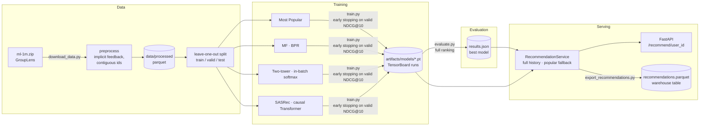

# Movie Recommender — a PyTorch RecSys on MovieLens 1M

[](https://github.com/Rimmer-23/movie-recommender/actions/workflows/ci.yml)


An end-to-end recommender system built from scratch in **PyTorch**: data pipeline,
four models of increasing sophistication (Most Popular → BPR matrix factorisation →
two-tower retrieval → SASRec), a single leakage-free **full-ranking** evaluation protocol,
a **FastAPI** recommendation service, a batch export to a warehouse-style **parquet** table,
Docker and CI.

> **TL;DR** — the sequential model (SASRec) reaches **NDCG@10 = 0.175** on the held-out test
> set: about **4.8× BPR matrix factorisation** and **9.7× the popularity baseline**, ranking
> against the whole catalogue of 3,706 movies (no sampled negatives).

### What this project demonstrates

- **Modelling:** four recommenders implemented from scratch behind one interface — BPR with
  negative sampling, a two-tower model with in-batch softmax and logQ correction, and a causal
  Transformer (SASRec) with explicit attention masks.
- **Evaluation rigour:** leave-one-out by time, full ranking, seen-item exclusion, validation-only
  model selection, fixed seeds, unit-tested metrics and leakage tests.
- **Engineering:** config-driven training (YAML → dataclasses), shared training loop with early
  stopping and TensorBoard, 64 pytest tests on synthetic data, ruff, GitHub Actions.
- **Delivery:** REST API with a cold-start fallback, a typed parquet export for a data
  warehouse, and a slim CPU-only Docker image.

### Quick start

```bash
pip install torch --index-url https://download.pytorch.org/whl/cpu && pip install -e ".[dev]"
python scripts/download_data.py && python scripts/train.py --model all
python scripts/evaluate.py && uvicorn recsys.api:app --port 8000
# → http://localhost:8000/docs
```

## Results

Leave-one-out by time, ranking against **all 3,706 movies** (no sampled negatives), items the
user has already rated excluded. Model selection and early stopping on validation; the test set
is evaluated once at the end.

| Model | Recall@10 | NDCG@10 | Recall@20 | NDCG@20 | *valid NDCG@10* |
|---|---:|---:|---:|---:|---:|
| Most Popular | 0.0369 | 0.0180 | 0.0680 | 0.0258 | *0.0206* |
| MF (BPR) | 0.0715 | 0.0364 | 0.1270 | 0.0503 | *0.0389* |
| Two-tower | 0.0757 | 0.0381 | 0.1280 | 0.0511 | *0.0400* |
| **SASRec** | **0.3050** | **0.1753** | **0.4200** | **0.2045** | ***0.1865*** |

Test metrics over all 6,040 users; the last column is the validation score used for model
selection. Produced by `python scripts/evaluate.py` (also written to `artifacts/results.md`).


**What the numbers say**

- **Order matters most.** SASRec beats the order-agnostic models by a wide margin because the
  next movie a user rates is strongly tied to what they rated just before: ML-1M users rate in
  sessions, often working through series, franchises and genres. MF and the two-tower model
  summarise a user as one static taste vector and cannot exploit recency.
- **SASRec ≥ MF ≥ Most Popular holds on every metric**, as expected. Personalisation alone
  (MF) doubles the popularity baseline.
- **Two-tower ≈ MF.** With ~160 interactions per user, the ID embeddings already capture taste;
  demographics and genres add little. Its training trick matters much more than its features:
  without the **logQ correction**, in-batch negatives over-penalise popular movies and
  validation NDCG@10 collapses from 0.040 to 0.016 — below the popularity baseline.
- **Test is slightly lower than validation** for every model: the test item is one step further
  from the training data, and models are not retrained on the validation interaction.
- Absolute values are lower than many published numbers because ranking is against **all**
  items, not 100 sampled negatives, which is known to inflate metrics.

## Architecture



Every model implements the same interface (`fit`, `recommend(user_ids, k, exclude_seen=True)`,
`save`, `load`), so evaluation, the API and the batch export are model-agnostic. All torch
models share one training loop (`TorchRecommender.fit`) with validation-based early stopping,
best-checkpoint restoring and TensorBoard logging; they only define their network, data
loader and `training_step`.

## Data

[MovieLens 1M](https://grouplens.org/datasets/movielens/1m/): 1,000,209 ratings from 6,040
users on 3,706 movies (2000–2003), every user with at least 20 ratings. See
[`notebooks/01_eda.ipynb`](notebooks/01_eda.ipynb) for a short EDA.

- **Implicit feedback:** every rating is a positive interaction, regardless of its value.
- **Chronology:** each user's history is sorted by timestamp. 53% of consecutive events share
  a timestamp (bulk rating sessions); a *stable* sort keeps the original file order for ties,
  so the split is deterministic.
- **IDs:** users are re-indexed to `0..6039`, movies to `1..3706`; item `0` is padding.
- The data is downloaded on demand and **never committed** (`data/` and `artifacts/` are
  git-ignored) — the MovieLens licence does not allow redistribution.

## Evaluation protocol

Identical for every model (`src/recsys/evaluate.py`, `src/recsys/metrics.py`):

| | |
|---|---|
| Split | per user, chronological: last interaction → **test**, second-to-last → **validation**, the rest → **train** |
| Validation input | train history |
| Test input | train + validation history (models are *not* retrained) |
| Candidates | **full ranking** over all items; items in the input history are excluded |
| Metrics | Recall@10, NDCG@10, Recall@20, NDCG@20 (one relevant item, so Recall@k = HitRate@k) |
| Selection | early stopping and model choice on validation NDCG@10; test reported once |
| Seeds | fixed (`seed: 42`) for Python, NumPy, PyTorch, samplers and negative sampling |

Metric implementations are unit-tested against hand-computed values; split tests assert that
no validation/test item appears in the input history and that train events precede them.

## Models

| Model | Idea | Loss / training |
|---|---|---|
| **Most Popular** (`popular.py`) | rank items by train interaction count | — |
| **MF (BPR)** (`mf.py`) | user & item `nn.Embedding`, dot-product score | BPR with uniform negatives (re-drawn if seen), L2 on used embeddings |
| **Two-tower** (`two_tower.py`) | user tower = user ID + gender/age/occupation → MLP; item tower = movie ID + genres (`EmbeddingBag`) → MLP; cosine / temperature | in-batch softmax (1,023 negatives per positive) with logQ popularity correction and false-negative masking |
| **SASRec** (`sasrec.py`) | causal self-attention over the last 200 items: item + learned positional embeddings, 2 pre-LN blocks, 1 head, hidden 64, dropout 0.2 | full-softmax cross-entropy over all items at every position |

All hyperparameters live in [`configs/*.yaml`](configs) and are loaded into dataclasses.
Light tuning on **validation** NDCG@10 only (each config documents what was tried):

| Model | Tried | Kept |
|---|---|---|
| MF | L2 1e-5 / 1e-4 / 1e-3, lr 1e-3 / 3e-3 | L2 1e-5, lr 1e-3 (1e-4 tied: 0.0390 vs 0.0389) |
| Two-tower | lr 1e-3 / 3e-3, temperature 0.05 / 0.1, logQ on / off | lr 3e-3, τ = 0.05, logQ on (0.0338 → 0.0400) |
| SASRec | architecture fixed by design; lr 1e-3 vs 2e-3 at an equal 30-epoch budget | lr 1e-3 (2e-3 converges faster: 0.176 vs 0.164 at epoch 30) |

## How to run

Requires Python 3.11+. Install CPU PyTorch first (or the CUDA build for a GPU; the device is
picked automatically: CUDA → MPS → CPU), then the project:

```bash
python -m venv .venv && source .venv/bin/activate   # Windows: .venv\Scripts\activate
pip install torch --index-url https://download.pytorch.org/whl/cpu
pip install -e ".[dev]"
```

One command per step:

```bash
python scripts/download_data.py                 # 1. download + preprocess + print stats
python scripts/train.py --model all             # 2. train popular, mf, two_tower, sasrec
python scripts/evaluate.py                      # 3. valid/test table, picks the best model
python scripts/export_recommendations.py --k 10 # 4. artifacts/recommendations.parquet
uvicorn recsys.api:app --port 8000              # 5. serve the best model
```

Train a single model with `python scripts/train.py --model sasrec` (optionally
`--config path.yaml`, `--epochs N`, `--device cpu`). Training curves:
`tensorboard --logdir artifacts/runs`; the figure above is produced by
`python scripts/plot_training_curves.py`.

Training time on a 6-core desktop CPU (Intel i5-8400, no GPU): Most Popular < 1 s,
MF ≈ 2–3 min (35 epochs), two-tower ≈ 15 min (33 epochs), SASRec ≈ 2 h
(152 epochs × ~50 s, early-stopped; best epoch 132). Evaluating all four models takes
~15 s and the batch export ~4 s.

### API

```bash
curl "http://localhost:8000/health"
curl "http://localhost:8000/recommend/1?k=5"
```


User 1's most recent ratings are *Aladdin, Toy Story, A Bug's Life, Antz, Hunchback of
Notre Dame, Hercules, Mulan, Pocahontas*. SASRec continues the sequence:

```json
{
  "user_id": 1,
  "model": "sasrec",
  "fallback": false,
  "recommendations": [
    {"rank": 1, "movie_id": 2092, "title": "Return of Jafar, The (1993)", "score": 7.74},
    {"rank": 2, "movie_id": 1064, "title": "Aladdin and the King of Thieves (1996)", "score": 7.47},
    {"rank": 3, "movie_id": 1688, "title": "Anastasia (1997)", "score": 7.27},
    {"rank": 4, "movie_id": 364, "title": "Lion King, The (1994)", "score": 7.15},
    {"rank": 5, "movie_id": 3054, "title": "Pokémon: The First Movie (1998)", "score": 6.67}
  ]
}
```

- `user_id` is the original MovieLens user id. Recommendations use the user's **full**
  history (all of their ratings) and never include movies they have already rated.
- Unknown users get the most popular movies (`"fallback": true, "model": "popular"`).
- `k` must be between 1 and 100. Interactive docs at `/docs`.
- `RECSYS_MODEL=mf` serves a specific model instead of the best one; `RECSYS_ARTIFACTS_DIR`
  and `RECSYS_DATA_DIR` change the input locations.

### Batch export

`scripts/export_recommendations.py` writes top-k for every user to
`artifacts/recommendations.parquet`, as if delivering an enriched table to a data warehouse:

| column | type | |
|---|---|---|
| `user_id` | int32 | MovieLens user id |
| `rank` | int16 | 1 = best |
| `movie_id` | int32 | MovieLens movie id |
| `title` | string | movie title |
| `score` | float32 | model score (higher is better) |
| `model` | string | model that produced the row |
| `generated_at` | timestamp[us, UTC] | one value per export run |

### Docker

The image contains the code and CPU-only PyTorch; data and trained models are mounted at
runtime (they cannot be redistributed):

```bash
docker build -t movie-recommender .
docker run --rm -p 8000:8000 \
  -v "$(pwd)/artifacts:/app/artifacts:ro" \
  -v "$(pwd)/data/processed:/app/data/processed:ro" \
  movie-recommender
```

or simply `docker compose up --build`.

### Tests and linting

```bash
ruff check . && ruff format --check .
pytest
```

The test suite runs on a small synthetic dataset in the MovieLens schema (no download needed):
metric correctness, split leakage, model output shapes and causality, tiny end-to-end training
runs with save/load round trips, and the API endpoints via FastAPI's `TestClient`. CI
(GitHub Actions) runs ruff and pytest on Python 3.11 and 3.12 and builds the Docker image on
every push and pull request.

## Project structure

```
.
├── configs/                  # one YAML per model (hyperparameters + training settings)
├── scripts/
│   ├── download_data.py      # download, preprocess, print dataset stats
│   ├── train.py              # python scripts/train.py --model sasrec | all
│   ├── evaluate.py           # valid/test results table, best-model selection
│   ├── export_recommendations.py
│   └── plot_training_curves.py
├── src/recsys/
│   ├── data.py               # loading, preprocessing, leave-one-out split, torch Datasets
│   ├── metrics.py            # Recall@k, NDCG@k
│   ├── evaluate.py           # full-ranking evaluation
│   ├── config.py             # YAML → dataclasses, paths
│   ├── models/
│   │   ├── base.py           # Recommender interface + shared torch training loop
│   │   ├── popular.py
│   │   ├── mf.py
│   │   ├── two_tower.py
│   │   └── sasrec.py
│   ├── serving.py            # model + catalogue + fallback, shared by API and export
│   └── api.py                # FastAPI app
├── notebooks/01_eda.ipynb
├── tests/                    # pytest suite on synthetic data
├── docs/training_curves.png
├── Dockerfile, docker-compose.yml
└── .github/workflows/ci.yml
```

## Next steps

- **Stronger sequential models:** BERT4Rec / gSASRec-style training, longer sequences for
  heavy users (sliding windows instead of keeping only the last 200 items), side features
  (genres, timestamps) in SASRec.
- **Two-tower:** feed the user's recent history into the user tower (YouTube-DNN style) so it
  generalises to new users without retraining; mixed negatives (in-batch + uniform).
- **Retrieval at scale:** export item vectors to an ANN index (FAISS / ScaNN) and serve
  candidate generation + a ranking stage instead of brute-force scoring.
- **Evaluation:** confidence intervals via bootstrap over users, beyond-accuracy metrics
  (coverage, novelty, popularity bias), a global temporal split as a second protocol.
- **MLOps:** experiment tracking (MLflow / W&B), model registry with versioned artifacts,
  scheduled batch export, request logging and online A/B evaluation.
