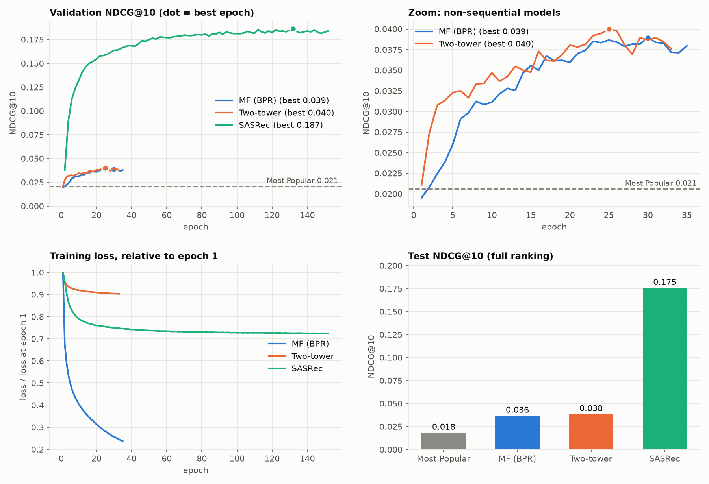
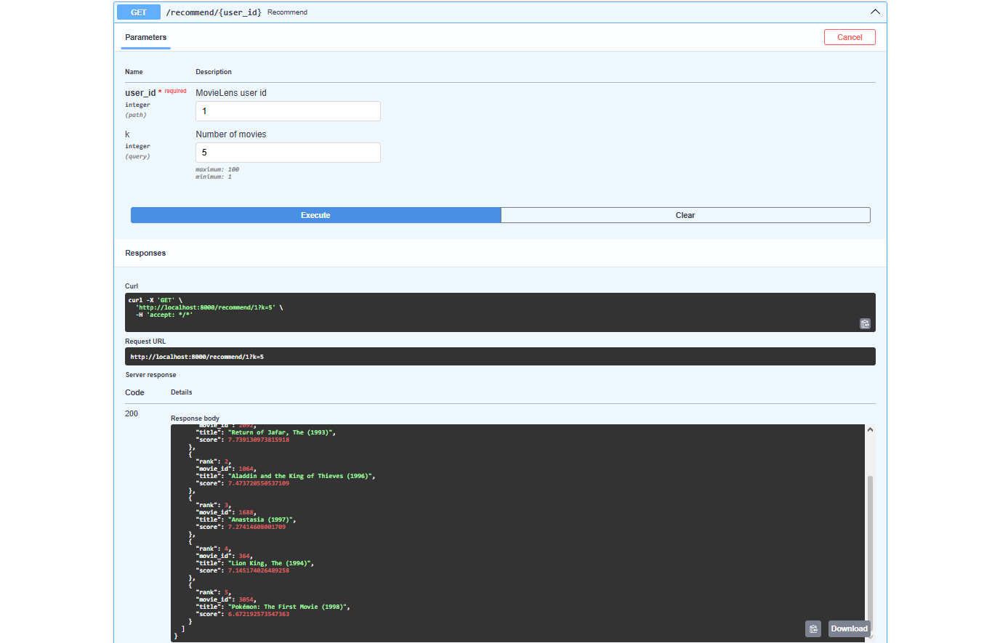
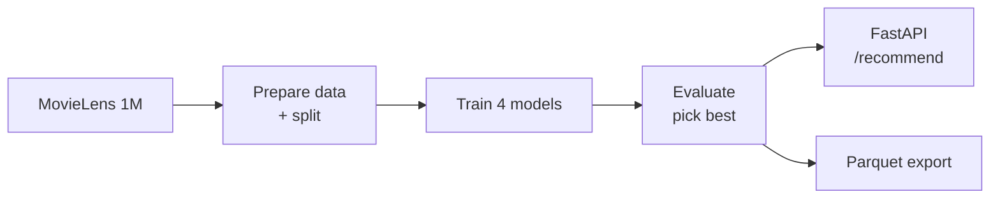

# 🎬 Movie Recommender

[](https://github.com/Rimmer-23/movie-recommender/actions/workflows/ci.yml)


A movie recommender system built from scratch in **PyTorch** on
[MovieLens 1M](https://grouplens.org/datasets/movielens/1m/) (1M ratings, 6k users, 3.7k movies).

It predicts **which movie a user will watch next**, serves recommendations through a REST API
and exports them as a parquet table.

## Results

Four models, from simple to advanced, evaluated the same way (test set):

| Model | Idea | NDCG@10 | Recall@10 |
|---|---|---:|---:|
| Most Popular | recommend what everyone watches | 0.018 | 0.037 |
| MF (BPR) | learn each user's taste | 0.036 | 0.072 |
| Two-tower | taste + user/movie features | 0.038 | 0.076 |
| **SASRec** | **Transformer over the watch history** | **0.175** | **0.305** |

**SASRec is ~5× better than the other models**: what you watched *last* is the best hint of what
you'll watch *next*, and only SASRec looks at the order of the history.



<details>
<summary>How the models are evaluated</summary>

- For every user, the **last** movie is hidden for the test, the one before it for validation;
  the model learns from everything earlier.
- The model ranks **all 3,706 movies** (movies the user already rated are excluded) and we check
  where the hidden movie lands.
- **Recall@10** — how often it is in the top 10. **NDCG@10** — same, but rewards a higher position.
- Early stopping and model choice use validation only; the test is computed once at the end.
- Full numbers (incl. @20 and validation): `artifacts/results.md` after `scripts/evaluate.py`.
</details>

## Demo

User 1 recently rated *Aladdin, Mulan, Pocahontas, Hercules, Toy Story…* — SASRec suggests:



Unknown users get the most popular movies.

## Quick start

```bash
# 1. install
pip install torch --index-url https://download.pytorch.org/whl/cpu
pip install -e ".[dev]"

# 2. run the pipeline
python scripts/download_data.py           # download + prepare data
python scripts/train.py --model all       # train 4 models (SASRec ≈ 2 h on CPU)
python scripts/evaluate.py                # results table, picks the best model
python scripts/export_recommendations.py  # top-10 for every user → parquet

# 3. serve
uvicorn recsys.api:app --port 8000        # open http://localhost:8000/docs
```

Or serve with Docker (data and models are mounted, not baked in):

```bash
docker compose up --build
```

## How it works



| Part | Where |
|---|---|
| Data loading, split, PyTorch datasets | `src/recsys/data.py` |
| Models (shared interface: `fit` / `recommend` / `save` / `load`) | `src/recsys/models/` |
| Metrics and evaluation | `src/recsys/metrics.py`, `src/recsys/evaluate.py` |
| API and export | `src/recsys/api.py`, `src/recsys/serving.py` |
| Hyperparameters (one YAML per model) | `configs/` |
| Scripts for each step | `scripts/` |
| Tests (64, on synthetic data) | `tests/` |
| Data exploration | `notebooks/01_eda.ipynb` |

<details>
<summary>Model details</summary>

- **MF (BPR):** user and movie embeddings, dot-product score, trained to rank a watched movie
  above a random unwatched one.
- **Two-tower:** user tower (ID + gender/age/occupation) and movie tower (ID + genres), trained
  with in-batch negatives. A popularity correction (logQ) is essential — without it the model
  is worse than Most Popular.
- **SASRec:** 2 self-attention blocks over the last 200 movies (hidden 64, dropout 0.2),
  predicts the next movie out of the whole catalogue.
- Training on a 6-core CPU: MF ≈ 3 min, Two-tower ≈ 15 min, SASRec ≈ 2 h.
</details>

<details>
<summary>API and export reference</summary>

- `GET /health` — status and the model in use.
- `GET /recommend/{user_id}?k=10` — top-k movies (`k` from 1 to 100) with titles and scores;
  movies the user already rated are excluded.
- `RECSYS_MODEL=mf` serves a specific model instead of the best one.
- Export columns: `user_id, rank, movie_id, title, score, model, generated_at`.
</details>

## Notes

- Data and trained models are **not** in the repo (MovieLens license) — the scripts download and
  create them.
- Tests and linting: `pytest --cov` and `ruff check .` (also run by CI on every push).
- CI also builds the Docker image, starts it on a tiny synthetic dataset and checks the endpoints.
- Possible next steps: use watch history in the two-tower model, an ANN index for fast
  retrieval, experiment tracking.
